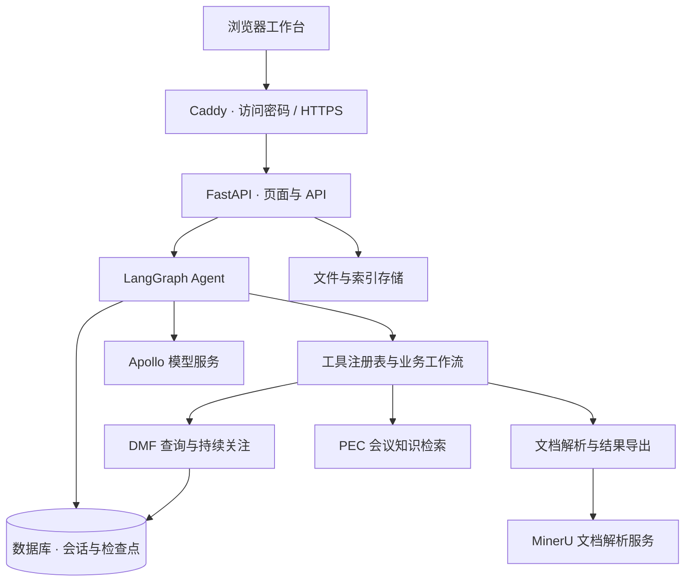

# Enterprise Research Agent

面向医药研发与企业研究场景的对话式工作台，将 **DMF 查询、文档分析、会议知识检索和结果导出** 集成到同一个 Web Agent 中。

项目使用 FastAPI 提供页面与 API，使用 LangGraph 编排工具调用和需要用户确认的工作流，并提供会话持久化、请求追踪、模型用量记录及场景评估能力。前端由后端直接提供，无需单独构建 Node.js 应用。

[快速开始](#快速开始) · [配置说明](#配置说明) · [部署指南](docs/DEPLOYMENT.md) · [开发文档](#开发文档)

## 核心能力

| 能力 | 说明 |
| --- | --- |
| 对话式 Agent | 根据问题调用业务工具，支持多步执行、跨轮上下文和工作流暂停与恢复。 |
| DMF 查询与导出 | 按 DMF 编号、申请商、成分等条件查询，支持结果整理与 Excel 导出。 |
| 文档驱动查询 | 从上传文档中提取查询条件，经过用户确认或修改后执行 DMF 查询。 |
| 会议知识检索 | 对 PEC 等会议资料建立文本块与向量索引，结合 Topic、重排和来源位置辅助回答。 |
| 知识库管理 | 提供资料清单、上传、解析检查、索引更新及任务状态接口。 |
| PPTX 与图片处理 | 提取演示文稿结构与逐页内容，支持图片识别及 Project Slide 相关工作流。 |
| DMF 持续关注 | 可选启用历史快照、关注清单、变更检测及邮件通知。 |
| 可观测与评估 | 记录请求级 Trace、工具执行与模型用量，提供确定性场景回归和真实服务评估入口。 |

可尝试的任务示例（需要配置对应服务并准备资料）：

- “查询成分为 Ibuprofen 的 DMF 信息，并导出 Excel。”
- “从这份文档提取查询条件，确认后再查询。”
- “根据已入库的会议材料，整理某项目的讨论结论并给出来源。”

## 技术架构



本地开发可直接运行 FastAPI。Docker Compose 部署包含应用、PostgreSQL 和 Caddy，并通过持久化卷保存数据库、资料和生成文件。

## 快速开始

### 1. 获取代码并安装依赖

建议使用 Python 3.12，与项目 Web 镜像保持一致。在 PowerShell 中执行：

```powershell
git clone https://github.com/yuxinyanyyx-ai/enterprise-research-agent.git
cd enterprise-research-agent
python -m venv .venv
.\.venv\Scripts\Activate.ps1
python -m pip install -r requirements.txt
Copy-Item .env.example .env
```

Linux / macOS 的虚拟环境激活与配置复制命令为：

```bash
source .venv/bin/activate
cp .env.example .env
```

`.env.example` 提供基础配置；模型接入需要在 `.env` 中补充下文列出的 Apollo 配置。请替换示例中的占位值。

### 2. 初始化数据库并启动

在仓库根目录执行：

```powershell
python -m alembic upgrade head
python -m uvicorn src.main:app --host 127.0.0.1 --port 8010
```

- 工作台：<http://127.0.0.1:8010>
- API 文档：<http://127.0.0.1:8010/docs>
- 健康检查：<http://127.0.0.1:8010/health>

**未配置外部服务也可以启动页面和健康检查。** 对话、文档解析、索引和查询等操作仍依赖相应配置、服务访问权限及数据；页面启动成功不代表这些功能已就绪。

本地入口会读取 `.env`。默认未启用 PostgreSQL 检查点，对话图状态使用内存保存，进程重启后不保证完整恢复。默认开发服务仅监听本机。

## 配置说明

本地运行使用仓库根目录的 `.env`；Compose 使用 `docker/deployment.env`。完整部署示例见 [docker/deployment.env.example](docker/deployment.env.example)。

| 配置项 | 用途与启用条件 |
| --- | --- |
| `APOLLO_CLIENT_ID`、`APOLLO_CLIENT_SECRET`、`APOLLO_TOKEN_URL` | Apollo 认证配置，对话与依赖模型的功能需要。 |
| `APOLLO_BASE_URL`、`APOLLO_MODEL` | 模型服务地址与模型名称。当前模型适配通过 Apollo 获取访问令牌。 |
| `APOLLO_EMBEDDING_MODEL`、`APOLLO_RERANK_MODEL` | 知识库向量索引和检索重排使用的模型。 |
| `APOLLO_VISION_MODEL` | 可选图片识别模型；未配置时使用 `APOLLO_MODEL`。 |
| `MINERU_TOKEN` | MinerU 文档解析服务凭证；基础示例使用 `MINERU_MODEL_VERSION=vlm`。 |
| `DATABASE_URL` | 业务数据库连接；基础示例使用 SQLite，Compose 使用 PostgreSQL。 |
| `AGENT_CHECKPOINT_ENABLED` | 启用持久化图检查点；需配置 PostgreSQL。 |
| `AGENT_MEMORY_ENABLED` | 可选长期记忆，默认关闭；身份与隔离要求见[记忆说明](docs/AGENT_MEMORY.md)。 |
| `DMF_HISTORY_ENABLED` | 启用 DMF 历史快照前先执行数据库迁移。 |
| `DMF_WATCHLIST_ENABLED` | 启用 DMF 关注清单，依赖 `DMF_HISTORY_ENABLED=true`。 |
| `DMF_NOTIFICATION_ENABLED` | 可选邮件通知，还需配置 SMTP 和运行通知处理任务。 |
| `AGENT_CONTEXT_WINDOW_TOKENS` | 模型上下文窗口预算，应按接入模型的实际容量配置。 |

当前模型入口位于 [`src/llm/apollo.py`](src/llm/apollo.py)。接入其他模型网关时，需要满足现有认证与接口约定，或修改对应适配层。

### 准备会议知识库

将获准使用的 PPTX、DOCX、PDF 或 XLSX 文件放入 `data/pec/sources/`。完成模型配置后执行：

```powershell
python -m src.pec.knowledge.chunk_index update
python -m src.pec.knowledge.chunk_index status
```

也可按资料文件夹更新：

```powershell
python -m src.pec.knowledge.chunk_index update --scope PEC1
```

索引更新可能调用解析、模型或向量服务。Topic 库通过独立的离线流程构建；普通索引更新不会自动重建 Topic。文件组织、模型配置与检索逻辑见 [PEC 知识库说明](docs/PEC_KNOWLEDGE.md)。

### 启用 DMF 关注与通知

完成数据库迁移并启用历史与关注清单后，可通过独立 Worker 执行到期任务：

```powershell
# 执行一轮后退出
python -m src.dmf_watchlist.worker --once

# 持续运行
python -m src.dmf_watchlist.worker
```

Compose 默认启动 Web、数据库和代理，**不会自动启动关注清单或邮件 Worker**。历史、调度及 SMTP 配置见 [DMF 历史与关注清单](docs/DMF_HISTORY.md)和[邮件通知说明](docs/DMF_EMAIL_NOTIFICATIONS.md)。

## Docker Compose 部署

适用于单台 Linux 服务器，也可使用 Docker Desktop 的 Linux 容器引擎进行本地验证。需要 Docker 和支持可选 `env_file` 的 Docker Compose 2.24 或更新版本。

先创建部署配置：

```powershell
Copy-Item docker\deployment.env.example docker\deployment.env

# 生成数据库密码，填入 POSTGRES_PASSWORD
python -c "import secrets; print(secrets.token_hex(32))"

# 交互生成网站密码哈希，填入 APP_PASSWORD_HASH
docker run --rm -it caddy:2-alpine caddy hash-password
```

编辑 `docker/deployment.env`，填入密码、哈希及所需服务配置。`APP_PASSWORD_HASH` 保留示例中的单引号，避免 `$` 被解释。随后执行：

```powershell
docker compose --env-file docker/deployment.env config --quiet
docker compose --env-file docker/deployment.env build app
docker compose --env-file docker/deployment.env up -d --wait
docker compose --env-file docker/deployment.env ps
```

默认访问 <http://127.0.0.1:8080>，用户名为 `research`，密码为生成哈希时输入的明文密码。容器入口会先执行数据库迁移，再启动应用。

部署文件：

- [`compose.yaml`](compose.yaml)：应用、PostgreSQL、Caddy 及持久化卷。
- [`docker/Dockerfile.web`](docker/Dockerfile.web)：Python 3.12 Web 镜像，包含 LibreOffice 和中文字体。
- [`docker/Caddyfile`](docker/Caddyfile)：访问密码与反向代理。

域名、HTTPS、备份和更新步骤见[完整中文部署指南](docs/DEPLOYMENT.md)。现有 `docker/Dockerfile`、Helm Chart 和 Jenkins 配置属于旧企业部署模板，本套 Compose 使用 `docker/Dockerfile.web`。

## 项目结构

```text
.
├── src/
│   ├── main.py                 # FastAPI 入口
│   ├── settings.py             # 应用配置
│   ├── agent/                  # LangGraph 编排、上下文与工具执行
│   ├── tools/                  # 工具注册、Provider 与业务适配
│   ├── llm/                    # Apollo 模型接入
│   ├── web/                    # 页面、静态资源与 API 路由
│   ├── services/               # 文档与业务工作流服务
│   ├── dmf_query/              # DMF 查询
│   ├── dmf_history/            # 历史快照
│   ├── dmf_watchlist/          # 关注清单与 Worker
│   ├── notifications/          # 邮件通知
│   ├── pec/                    # 会议知识库与检索
│   ├── mineru/                 # 文档解析接入
│   ├── agent_memory/           # 长期记忆
│   ├── agent_session/          # 会话持久化
│   └── observability/          # Trace 与用量记录
├── skills/                     # 项目 Agent 使用的技能指引
├── tests/                      # 单元、集成与场景评估
├── alembic/                    # 数据库迁移
├── docs/                       # 专项文档
├── docker/                     # 镜像与代理配置
├── data/pec/                   # 会议资料及索引目录
├── run_chat.py                 # 命令行对话入口
├── compose.yaml
└── requirements.txt
```

## 开发与验证

安装测试工具后，可运行确定性 Agent 场景评估：

```powershell
python -m pip install pytest
python -m pytest tests/test_agent_eval_cases.py -m agent_eval -q
```

该入口使用脚本化模型与外部服务替身，验证实际 Agent 编排、工具协议和业务断言；结果不能代表真实模型的工具选择准确率。真实 LLM、实时 DMF 和 Watchlist 集成评估需要单独配置与显式启用，详见 [Agent Eval](docs/AGENT_EVAL.md)。

新增普通工具时，在对应模块实现工具并通过 Provider 注册；新增 Provider 的组合入口为 [`src/tools/providers.py`](src/tools/providers.py)。需要暂停、检查点或跨轮恢复的工作流使用专门的工作流接入方式，详见[添加 Agent 工具](docs/ADDING_AGENT_TOOLS.md)。

## 开发文档

| 文档 | 内容 |
| --- | --- |
| [部署指南](docs/DEPLOYMENT.md) | Compose、访问密码、域名与 HTTPS、持久化和运维。 |
| [Web 工作区](docs/WEB_WORKSPACE.md) | 前端结构与交互约定；部分后端接口描述为早期设计记录，以当前路由实现为准。 |
| [PEC 知识库](docs/PEC_KNOWLEDGE.md) | 索引、Topic、检索、模型与资料准备。 |
| [文档到 DMF 工作流](docs/APOLLO_DOCUMENT_DMF_FLOW.md) | 文档提取、条件确认与查询流程。 |
| [DMF 历史与关注清单](docs/DMF_HISTORY.md) | 历史快照、持续关注与 Worker。 |
| [邮件通知](docs/DMF_EMAIL_NOTIFICATIONS.md) | SMTP、变更通知和摘要。 |
| [Agent 记忆](docs/AGENT_MEMORY.md) | 长期记忆及相关配置。 |
| [添加 Agent 工具](docs/ADDING_AGENT_TOOLS.md) | 工具注册与扩展。 |
| [上下文预算](docs/AGENT_CONTEXT_BUDGET.md) | 上下文容量与最终回答协议。 |
| [日志说明](docs/AGENT_LOGGING.md) / [可观测性](docs/OBSERVABILITY_UPDATE.md) | 日志、请求 Trace 与模型用量。 |
| [Agent Eval](docs/AGENT_EVAL.md) | 场景定义、离线回归与真实服务评估。 |

## 使用边界

当前 Compose 方案面向少量可信用户共享工作区。整站访问密码提供入口保护，各用户的资料权限仍需额外的应用级隔离设计。长期记忆及可信代理身份在 Compose 中默认关闭。

外部模型、MinerU、DMF 数据源及会议资料需要各自的访问权限。请按资料授权范围使用项目，并将真实凭证保存在本地配置中。镜像构建排除本地资料和运行结果，具体范围见 [`.dockerignore`](.dockerignore)。

